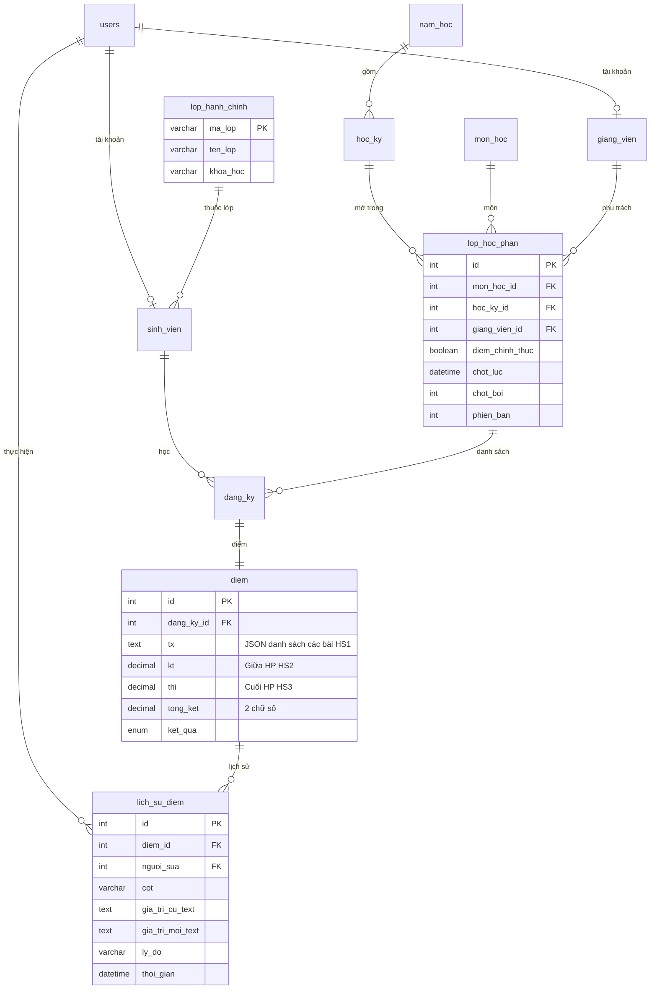
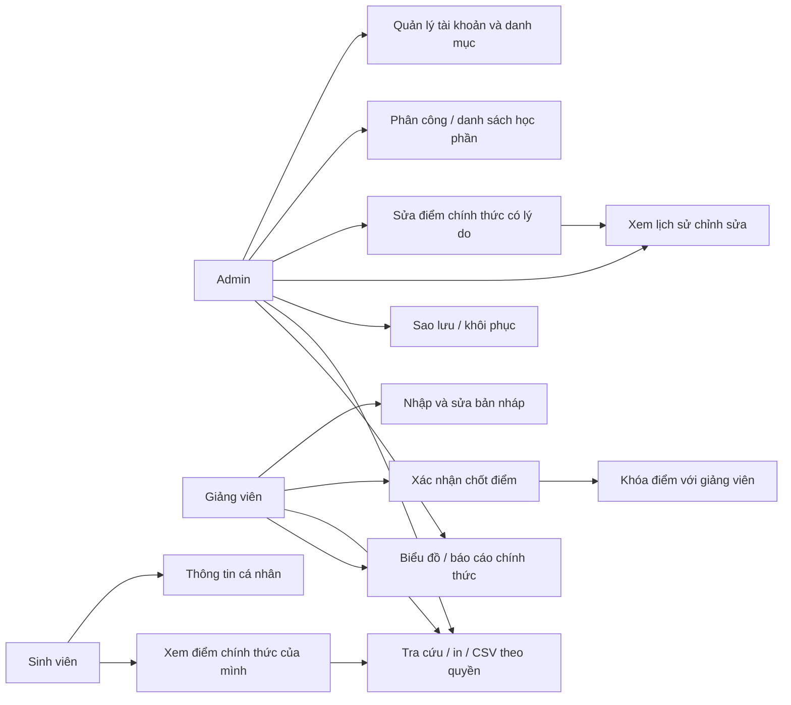

# Phân tích và thiết kế

## Phạm vi và quy tắc

Ba tác nhân: Admin quản lý hệ thống, giảng viên phụ trách học phần và sinh viên xem điểm cá nhân. Hệ thống chạy PHP/PDO/MySQL trên XAMPP, HTML/CSS/JS với Bootstrap và Chart.js. Mô tả chức năng chi tiết ở `CHUC_NANG.md`; yêu cầu gốc ở `YEU_CAU.md`.

Lớp học phần đi qua hai trạng thái: **nháp → chính thức**. Chỉ chốt khi toàn bộ sinh viên đủ điểm. Chốt là khóa quyền sửa của giảng viên, không có chức năng giảng viên tự mở khóa. Admin sửa chính thức phải có lý do và lưu lịch sử. Sinh viên và báo cáo chỉ lấy điểm chính thức. Học kỳ đóng ngăn giảng viên sửa/chốt bản nháp.

Khi lưu, hệ thống khóa hàng lớp bằng `SELECT ... FOR UPDATE`, kiểm tra quyền và phiên bản form, kiểm tra dữ liệu toàn lớp, lưu điểm và nhật ký trong cùng transaction. Bản form cũ sau một lần lưu hoặc thay đổi danh sách sẽ bị từ chối để tránh ghi đè.

## ERD

Ràng buộc đăng ký duy nhất `(lhp_id,sinh_vien_id)`, một hàng điểm cho một đăng ký. Liên kết lớp hành chính dùng mã lớp, cập nhật mã tự lan truyền qua khóa ngoại. Các cột điểm và tổng kết dùng `DECIMAL(4,2)`. Cột thực hành và trọng số cũ được giữ để bảo toàn dữ liệu lịch sử nhưng không dùng trong nghiệp vụ mới.

## Sơ đồ chức năng theo tác nhân

## Luồng khôi phục

Xác thực Admin → kiểm tra CSRF/mật khẩu/câu xác nhận → kiểm tra JSON và tên/cột bảng → lưu bản trước khôi phục → transaction xóa theo thứ tự con-trước, thêm cha-trước → kiểm tra khóa ngoại, tính lại điểm và kiểm tra điểm chính thức đầy đủ → commit → hủy phiên. Mọi lỗi trước commit dẫn đến rollback. Website không thực thi mã SQL từ tệp upload.
